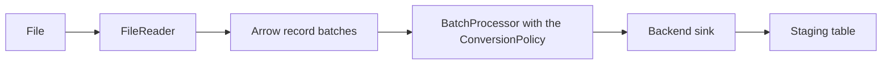

# Loaders

`orm_loader.loaders` loads files into staging tables. A file takes the same path on every backend and in every format:

Loading is infrastructure only. It carries no domain rules, streams files in bounded batches, and fails visibly instead of changing data.

| Page | Covers |
|------|------|
| [Readers](readers.md) | `FileReader`, the provided readers, format detection and how to add a format |
| [Conversion](conversion.md) | The policy that turns raw values into column types, and the column handlers |
| [Staging and sinks](staging.md) | `stage_file`, the backend sinks, deduplication and `normalise` |
| [Context and report](context.md) | `LoaderContext`, `LoadReport` and row accounting |

---

## Lifecycle

1. A reader is chosen from the file suffix, or passed explicitly, and yields the file as batches.
2. Each batch is converted to the ORM column types under the conversion policy. With `normalise=False` values are written as read.
3. The backend's bulk sink writes the batch into the staging table.
4. The staging table is optionally deduplicated.
5. The number of rows left in staging is returned, and the table layer merges them into the target.

Staging tables isolate a load from the production table, which makes rollback safe and merges repeatable. Merge behaviour belongs to the table mixins and the backend layer, not to the loader.

---

## Guarantees

- Ingestion is deterministic and no value is silently changed or lost.
- Every row read is loaded, rejected to a rejects file, or dropped as a duplicate. A load that cannot account for every row raises.
- Domain rules stay outside the loader.

The loader does not guarantee the correctness of the source data.
